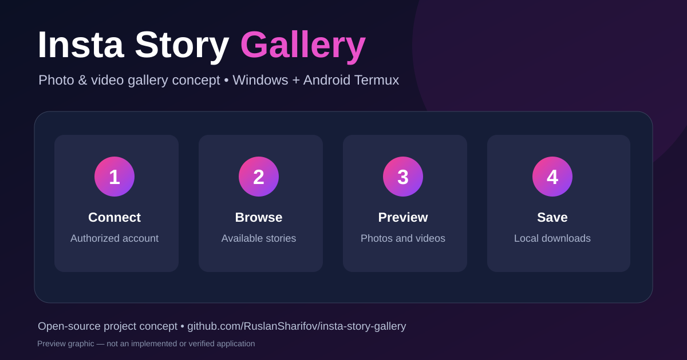

# Insta Story Gallery



A **local gallery application concept** for browsing permitted Instagram stories and saving photos/videos on your own device. **Current status: documentation and poster only. The runtime application has not been implemented in this repository yet.**

## How it is intended to work

1. Authorize access to an account through an appropriate supported method.
2. Enter a username and browse stories that your account has permission to access.
3. Preview available photo and video stories in a responsive gallery.
4. Save selected media to the device, respecting creators' rights and platform rules.

**Security:** Never upload exported browser cookies or session tokens to a remote website. Such data can grant access to your account. The visual poster represents the intended product, not a working screenshot.

## Windows (CMD)

Install [Git](https://git-scm.com/downloads) and clone the repository:

```bat
git clone https://github.com/RuslanSharifov/insta-story-gallery.git
cd insta-story-gallery
```

The application start command is **not yet available**, because the repository currently contains only documentation and the poster.

## Android (Termux)

Install Termux, open it and run:

```sh
pkg update && pkg upgrade
pkg install git
git clone https://github.com/RuslanSharifov/insta-story-gallery.git
cd insta-story-gallery
```

The application start command is **not yet available** on Termux either. Once an implementation is added, this section should specify its actual dependencies, run command, local address and device compatibility.

## Poster

Source: [assets/poster.svg](assets/poster.svg).
